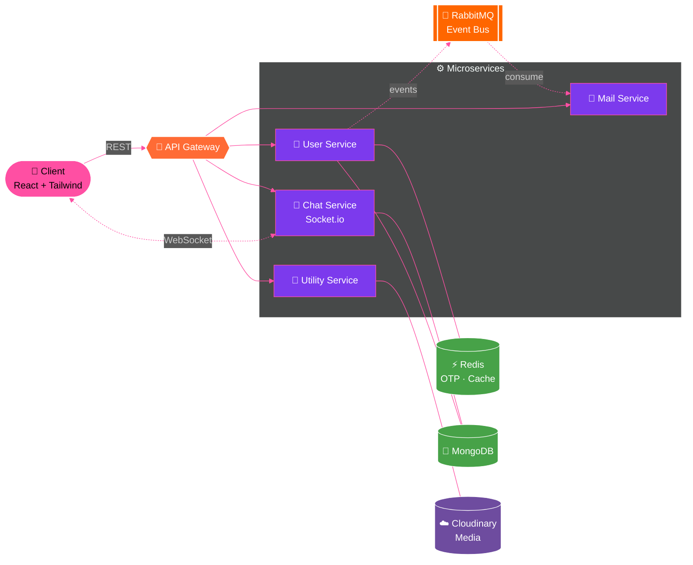
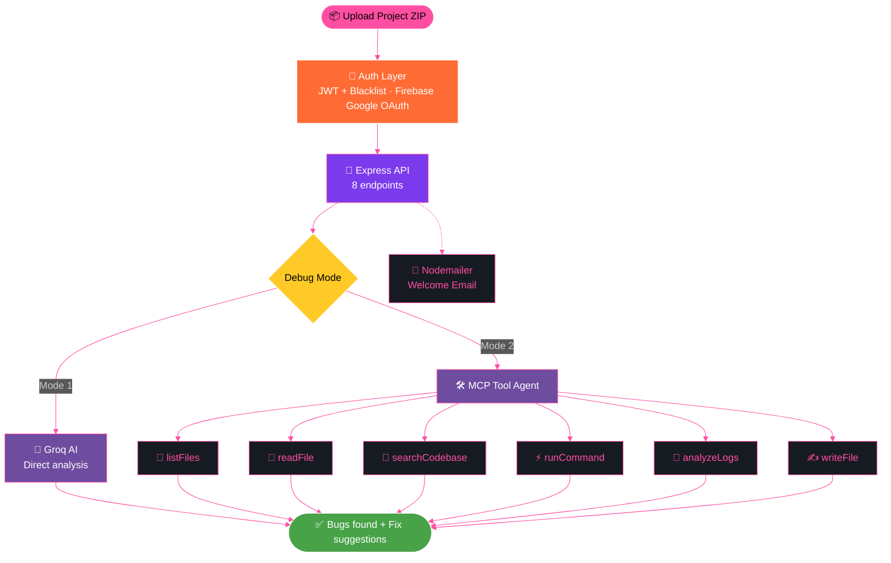
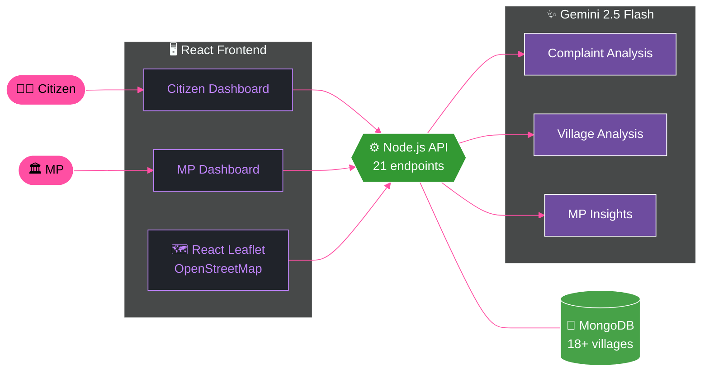
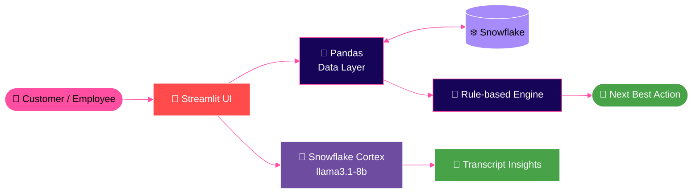
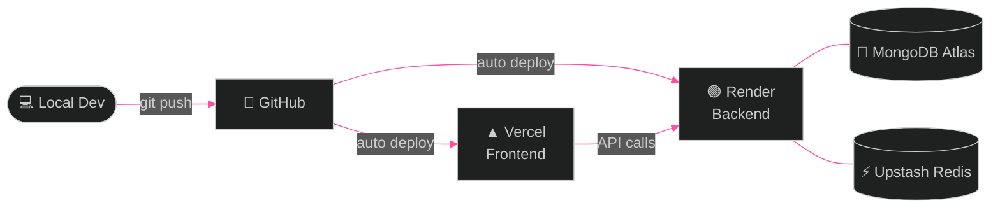
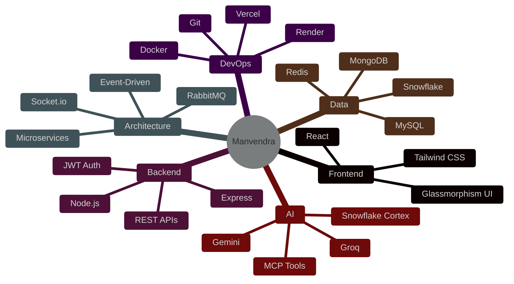

<!-- ===================== HEADER ===================== -->
<div align="center">


<br/><br/>

[](https://manvendra-portfolio-developer.vercel.app)
[](https://www.linkedin.com/in/manvendrabhardwaj-tech)
[](https://leetcode.com/u/Manvendra-2006/)
[](https://x.com/ManvendraB67835)
[](https://youtube.com/@RVDTECH)


[](https://github.com/Manvendra-2006)

</div>

---

<div align="center">

**[🚀 Projects](#-featured-projects)** · **[🏗️ Architecture](#️-system-architecture)** · **[🧬 Skills](#-skill-universe)** · **[🛠️ Tech](#️-tech-arsenal)** · **[📊 Stats](#-github-stats)** · **[🧩 DSA](#-dsa--problem-solving)**

</div>

---

## 👋 About Me


```js
const manvendra = {
  name: "Manvendra Bhardwaj (Buddy)",
  role: "Full Stack Developer",
  education: "B.Tech CSE (AI/ML) @ Rungta College of Engineering & Technology",
  location: "Bhilai, Chhattisgarh, India 🇮🇳",
  currently: {
    building:  "Real-world MERN apps & AI-powered platforms",
    learning:  "Microservices, RabbitMQ & System Design",
    exploring: "Event-Driven & Real-Time Architectures",
  },
  motto: "Ship. Learn. Repeat. 🚀",
};
```

- 🔭 Building **full-stack MERN projects** for portfolio & hackathons
- 🤖 Integrating **AI (Groq, Gemini, Snowflake Cortex)** into real products
- ⚡ Real-time features with **Socket.io / WebSocket**
- 🧩 Exploring **microservices** & **event-driven systems with RabbitMQ**
- 🎧 Fun fact: I debug faster with lo-fi music on

<br clear="right"/>

---

## 🚀 Featured Projects

<div align="center">

<table>
<tr>
<td width="50%" valign="top">

### 🐞 AI Debugger Assistant
Upload a project ZIP → AI debugs it **autonomously**, using Groq AI and 6 MCP tools.

`MERN` `Groq AI` `MCP` `JWT` `Firebase`

⚙️ 8 APIs · 6 MCP tools · Google OAuth

[](https://github.com/Manvendra-2006/AI-Debugger-Assistant)
[](https://ai-debugger-assistant-1g7f.onrender.com/)

</td>
<td width="50%" valign="top">

### 🏛️ CivicLoop
AI-powered **civic grievance & rural development** platform for Indian constituencies.

`React` `Node.js` `MongoDB` `Gemini 2.5 Flash` `Leaflet`

⚙️ 21 APIs · 3 AI services · Citizen & MP dashboards

[](https://github.com/Manvendra-2006/constituency-ai-platform)

</td>
</tr>
<tr>
<td width="50%" valign="top">

### 💬 ChatApp
Real-time chat on a **microservice architecture** — 1 API gateway + 4 services.

`Express` `Socket.io` `RabbitMQ` `Redis` `Cloudinary`

⚙️ 14 APIs · OTP login · Glassmorphism UI

[](https://github.com/Manvendra-2006/ChatApp)

</td>
<td width="50%" valign="top">


### 🌱 Ugaao
**Gamified environmental education** platform for schools & colleges.

`MERN` `MongoDB Atlas` `Upstash Redis` `Vercel` `Render`

⚙️ OTP via Redis · Separate frontend / backend deploys

</td>
<td width="50%" valign="top">

### 🌾 AI Farm Assistant
Agricultural AI platform with **crop disease analysis** & district officer command center.

`React` `Express` `MongoDB` `Firebase Auth` `Tailwind`

⚙️ Microservices · Google sign-in · Role-based routing

</td>
</tr>
</table>

</div>

---

## 🏗️ System Architecture

> Mere projects andar se kaise kaam karte hain 👇 (click karke expand karo)

<details open>
<summary><b>💬 ChatApp — Microservices + Event-Driven</b></summary>



`1 Gateway` · `4 Services` · `14 APIs` · `OTP Login` · `Real-time`

</details>

<details>
<summary><b>🐞 AI Debugger Assistant — Autonomous Debugging Agent</b></summary>



</details>

<details>
<summary><b>🏛️ CivicLoop — AI Civic Governance Platform</b></summary>



</details>

<details>
<summary><b>📊 Customer 360 & Next Best Action Engine</b></summary>



</details>

### 🌐 Deployment Pattern (mere projects mein)



---

## 🧬 Skill Universe



---

## 🛠️ Tech Arsenal

<div align="center">


**Core CS:** `DSA` · `OOP` · `DBMS` · `OS` · `Computer Networks` · `System Design`

</div>

---

## 📊 GitHub Stats

<div align="center">


[](https://github.com/ryo-ma/github-profile-trophy)

</div>

---

## 🧩 DSA & Problem Solving

<div align="center">

| Platform | Profile | Focus |
|:--------:|:-------:|:-----:|
| 🟡 **LeetCode** | [Manvendra-2006](https://leetcode.com/u/Manvendra-2006/) | Arrays · Trees · DP |
| 🟢 **GeeksForGeeks** | [manvendrabi3gd](https://www.geeksforgeeks.org/profile/manvendrabi3gd) | Core CS Problems |
| 🔵 **Codolio** | [Manvendra-2006](https://codolio.com/profile/Manvendra-2006) | Full Profile |

</div>


## 🎯 Currently Working On

```diff
+ Full Stack MERN applications with AI integration
+ REST API development with Node + Express
+ Real-time features with WebSocket & Socket.io
! Exploring: Microservices & RabbitMQ (event-driven systems)
! Exploring: System Design & Scalability
# Next: Authentication systems & cloud deployment
```

---

<div align="center">

### 💡 *"Code is not just instructions for machines — it's a craft, a story, a solution."*

**⭐ Star my repos if you find them helpful — let's grow together! 🚀**


</div>
